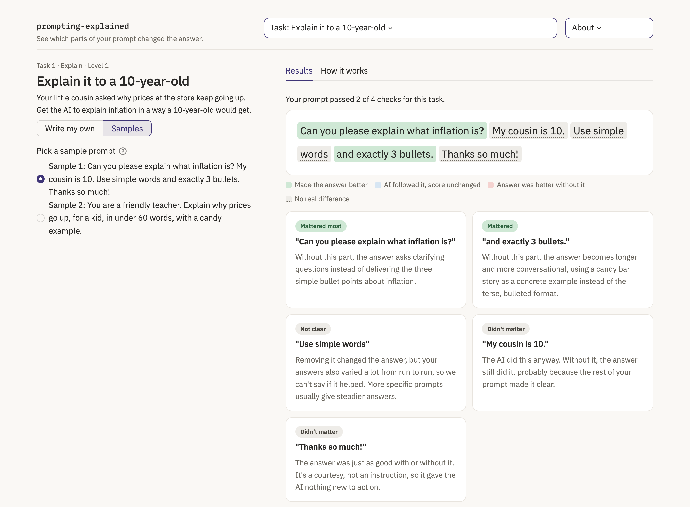
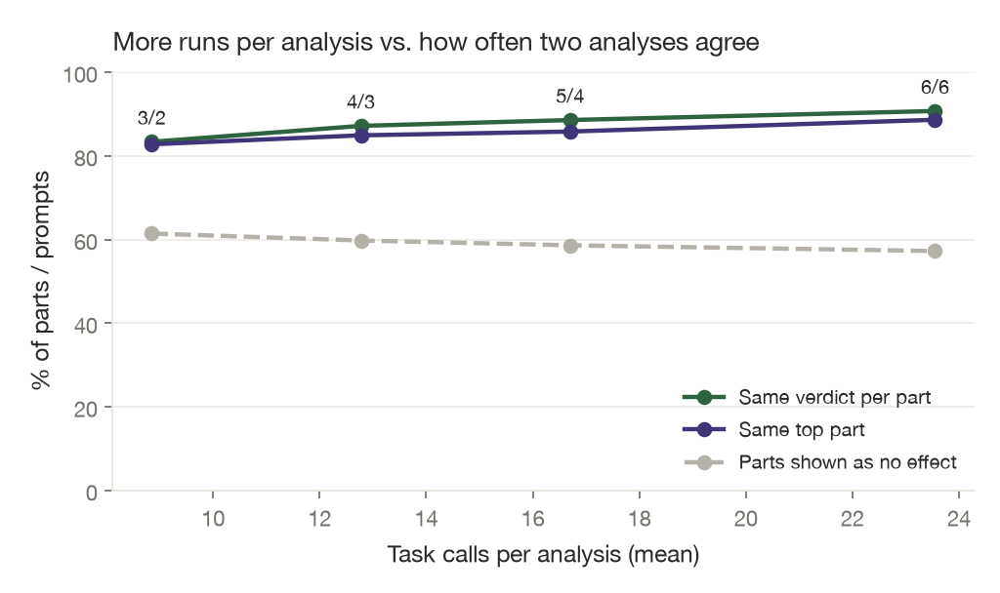

# prompting-explained

A small web app that shows which parts of your prompt actually changed an AI's answer.

You pick one of eight tasks, from explaining inflation to a 10-year-old to posting a bug report without leaking a customer's details. You write a prompt, and the app takes it apart. It runs your prompt a few times, then runs it again with one piece removed at a time, and tells you which pieces made a difference and which ones the AI would have handled anyway. "Please" and "thanks" almost never matter. "Use 3 bullet points" almost always does. Sometimes the attached email does all the work and nothing you wrote matters much, which is useful to know too.



I built this for an explainable AI course. The question I wanted to answer:

> Can perturbation-based attributions over prompt segments give everyday users faithful and stable explanations of how their wording shapes an LLM's output?

Short version of the answer, for one model (Claude Haiku 5.5) on 240 test prompts: mostly yes for the big effects, and no for small ones. The top-ranked parts really are the ones that matter: removing them hurts about 65% more than removing random parts. Rerunning the same analysis gives the same top part 78% of the time, and 86% of the time when that part's effect was clearly above the noise. Small effects get lost in the model's run-to-run randomness, so the app says so instead of guessing. When an attached document already says everything, almost nothing in the prompt matters, and the tool correctly finds nothing to rank.

## How it works

1. **Split the prompt into parts.** One model call splits the prompt into short phrases and labels each one (task, audience, format, constraint, politeness, and so on). The code then maps every part back onto the exact characters of the prompt, so removing a part removes exactly that text.
2. **Run the full prompt 3 times.** Each answer is scored by code against the task's checks. For the kid task those are: actually explains prices, 3 bullet points, 60 words or fewer, reading grade 5 or below. If an answer doesn't do the task at all, for example it asks "what should I explain?", it scores 0 whatever the other checks say.
3. **Remove one part at a time and run each version twice.** The drop in score is that part's effect. This is occlusion, or leave-one-out. Each effect is compared with its own noise floor: two standard errors of the difference between the runs with the part and the runs without it, and never less than 0.05. Smaller effects aren't reported as real.
4. **Remove the quiet parts together.** If two or more parts made no clear difference on their own, they are removed all at once and that version runs twice too. This catches parts that cover for each other ("under 60 words" and "keep it short") and parts that only pull the answer off course together. If the joint change clears its own noise floor, the app says so in a "Together, …" card.
5. **Check each part directly.** A second model call reads every answer and rates whether it does what each part of the prompt asked: yes, partly, no, or nothing to act on. If answers do it with the part and stop without it, but the score doesn't move, the AI "followed it". If they do it either way, the AI did it anyway. If they don't do it even with the part, it was ignored.
6. **Explain it in plain words.** Parts that mattered get one sentence written by the model comparing the two answers. Everything else is fixed text picked by the numbers, so the app never invents a number.

The colours are simple. Green means the part made the answer better at the task. Blue means the AI followed it but the task score didn't change. Red means the answer did better without it. Grey means no real difference. The "How it works" tab shows the actual numbers for anyone who wants to check.

Any document that comes with a task (the landlord's email, the job posting) is attached after your prompt and never removed.

## The tasks

| # | Task | Category | What the hidden checks look at |
|---|---|---|---|
| 1 | Explain it to a 10-year-old | Explain | 3 bullets, 60 words or fewer, reading grade 5 or below |
| 2 | Push back on a late fee | Write | A real reply, 120 words or fewer, cites the fee and lease, no apology |
| 3 | Job posting to JSON | Extract | Pure JSON, the right keys and values, no invented salary |
| 4 | Summarize a meeting for your boss | Write | 60 words or fewer, the decision/budget/deadline, no side topics |
| 5 | Recipe to shopping list | Extract | Only what you still need to buy, one per line, no cooking steps |
| 6 | Write an email subject line | Write | One line, 9 words or fewer, the invoice number, nothing pushy |
| 7 | Post a bug report without personal info | Responsible AI | Keeps the technical details, drops the name, email, phone, and address |
| 8 | Answer from the FAQ only | Responsible AI | Says the FAQ doesn't cover it, no speculating, short |

Each task's reference prompt passes every check on 5 out of 5 runs. Tasks 4 to 8 were designed after I noticed that on task 2 the attached document does most of the work. Weak prompts fail their checks often enough that the wording has something to show. For task 8 I added aqua aerobics classes to the FAQ as bait. Without them, the AI never guessed about the pool. With them, a weak prompt sometimes got "Yes, there's a pool."

## The XAI ideas behind it

| Idea | Where it comes from | How it shows up here |
|---|---|---|
| Occlusion | Zeiler and Fergus (2014); the course's attribution chapter | Remove a prompt part, rerun, measure the change |
| Perturbation explanations for text | LIME (Ribeiro et al., 2016) masks words and fits a local model | Same black-box idea, but with phrases instead of single words and no surrogate model |
| Shapley values / SHAP | Lundberg and Lee (2017) | Not used, on purpose. One part at a time is cheap and easy to explain, but it misses interactions. That is exactly why two parts that say the same thing can both show as grey |
| Target-specific attribution | Class-specific saliency (Simonyan et al., 2014) | Each check gets its own attribution, so "under 60 words" can help length and do nothing for reading level |
| Contrastive and counterfactual explanation | The course's example-based explanations chapter | "With this part / without it" is a minimal counterfactual: the smallest edit to your prompt and what changed |
| Faithfulness by deletion | Petsiuk et al. (2018); DeYoung et al. (2020) | Remove the top-ranked parts together with fresh model calls and compare against random parts |
| Stability | Alvarez-Melis and Jaakkola (2018) | Rerun whole analyses and check whether the verdicts agree |
| Generated rationales are not evidence | Turpin et al. (2023); the course's LLM prompting section | The model-written "why" sentence is labeled as a description, never as the measurement |

## Results

Everything below comes from `results/summary.md`, produced by `scripts/run_eval.py`. The model was `claude-haiku-5-5`, with thinking off and effort low. Each analysis used 3 baseline runs and 2 runs per removed part. The prompts are 240 synthetic ones: all 8 tasks × novice, average, and expert users, 10 each, written by an LLM. Expert prompts scored higher than novice ones on every task (0.97 vs 0.59 on average), so the synthetic users behave the way you'd hope. The gap is widest where nothing is attached to lean on: on the kid task it is 0.94 vs 0.36. Where the attached document does most of the work, it is small: the bug report is 1.00 vs 0.87.

**Faithfulness.** For the 79 prompts with at least 4 parts, I removed the 2 top-ranked parts together and compared that with removing 2 random parts, using new model calls each time. The top-2 removal dropped the score by 0.30 on average, against 0.18 for random parts (one-sided Wilcoxon p = 0.0002). The gap is large where wording matters (kid task 0.77 vs 0.45, JSON 0.60 vs 0.27, FAQ 0.42 vs 0.28) and absent on the landlord and meeting tasks. There, removing any 2 parts barely moves the score (under 0.07) because the attached email or notes carry the answer, so there is nothing for a ranking to find. With 3 parts removed there was no difference (0.36 vs 0.35). Most of these prompts have only 4 or 5 parts, so 3 random parts always overlap heavily with the top 3. That is a weak test, not evidence against the method.


**Stability.** I reanalyzed 80 prompts from scratch, 10 per task, keeping the same parts.
- The ranking of parts correlated well between the two runs: median Spearman 1.00, mean 0.77, over the 35 prompts with enough parts to rank.
- The top part was the same 78% of the time, and 86% of the time when it had cleared the noise floor in the first run.
- The helped / hurt / no effect verdict matched for 81% of parts. The fuller verdict (mattered / followed / did it anyway / ignored) matched for 72%.
- Splitting the same prompt 3 times gave identical parts 89% of the time.

**How many runs are enough?** The app runs the full prompt 3 times and each shortened prompt twice. To see what more runs would buy, I ran the same 80 prompts 12 times in full and 12 times per removed part. Then I compared pairs of analyses built from separate halves of those runs (`scripts/runs_experiment.py`, `results/runs_experiment.md`).

| Full runs / runs per part | Task calls (mean) | Same verdict per part | Same top part |
|---|---|---|---|
| 3/2 (the app) | 9 | 83% | 83% |
| 4/3 | 13 | 87% | 85% |
| 5/4 | 17 | 89% | 86% |
| 6/6 | 24 | 91% | 89% |

The 3/2 row matches the real reruns above (81% and 78%), so the setup reflects what users see. Nearly tripling the calls buys about 8 points of agreement. It also barely shrinks the share of parts shown as "no difference" (61% to 57%), so most grey verdicts are real non-effects, not noise hiding small effects. The landlord and privacy tasks gain the most, because their scores move in small steps. I kept 3/2 for the app: it keeps an analysis under a minute, and the gains are modest.



**What kinds of parts matter.** Grouped by the role the splitter assigned, over all 741 parts:
- Format instructions changed the score the most: mean effect 0.24, above the noise floor 70% of the time.
- Task instructions came close behind, at 0.23.
- Politeness (0.06) and tone (0.04) changed it the least.
- 45% of all parts asked for something the AI did anyway. On the landlord task it was 54 of 97 parts, because the attached email and lease already say everything.


**Can the per-part judge be trusted?** Some parts ask for exactly what a code check measures, like "under 60 words", "exactly 3 bullets", "only JSON", "don't apologize", or "keep the customer's details out". For those, the judge's yes/no on each answer can be checked against the code on the same answer (1,139 answers, section F of the summary). It agrees 88% of the time. It is reliable on format: bullets 96% and JSON only 93%, with kappa near 0.9. It is unreliable on length: 93 times it said an answer met a word limit that the answer broke, so it can't count words. On privacy it said "kept the details out" for 6 answers that leaked a name or email. Code checks drive the scores, and the judge only decides between "followed" and "did it anyway", so these misses affect the blue and grey labels, not the green and red ones.

**Does it match human intuition?** Before running anything, I wrote down what I expected for 71 parts across 24 fairly clean prompts (`results/expectations.yaml`). Under the current rules the tool agrees with me on 54 of them (76%, Cohen's kappa 0.60). When we disagreed, I was usually the one who was wrong: the AI fills in more than I expected. It writes an email even without "write a reply", and keeps replies short without being told. The per-part judge also missed one code block, which was a real tool mistake. `results/expectations_report.md` lists every disagreement.

**Messy prompts.** I also wrote 32 badly written prompts, 4 per task across all eight tasks. They had typos, text-speak, all caps, run-ons, vague asks, counterproductive instructions, leading questions, and one "ignore the email and write a poem". Raw agreement with my written-in-advance expectations dropped to 52% (44 of 85 parts). Reading every disagreement against the actual answers, about 35 of the 41 were my mistakes. A few examples:
- "for github issues" quietly kept the customer's name out of the report.
- "dont guess" made the AI speculate more, not less.
- "make up a salary" was refused.

About 6 were real weaknesses, and they changed the design (next section). The full write-up is in `results/messy_prompt_testing.md`. Prompt splitting held up on typos, emoji, Spanish and code blocks: every split reproduced the prompt exactly.

## Things that went wrong along the way

These shaped the design, so they're worth writing down.

- **The checks rewarded non-answers.** With "explain inflation" removed, the AI asked "what would you like me to explain?" That reply is short and simple, so it passed the length and reading checks and scored better than a real answer. The tool concluded the task instruction didn't matter. I added a "did it actually do the task" check that zeroes the score for questions back, and for advice when an email was asked for. This affected about 11% of answers.
- **One run per removed part made things up.** With a single run, "Thanks so much!" looked like it helped reading level. With two runs it fell back within noise.
- **Vague prompts are noisy.** Short prompts get very different answers from run to run, which hides real effects. Instead of saying "didn't matter" in that case, the app now says it can't tell.
- **The score alone was too narrow.** Code checks can see length and keywords. They can't see whether the reply still says "I paid on time". The per-part check fills that gap.
- **One noise floor for the whole prompt was too blunt.** It came from the full prompt's 3 runs. When those happened to agree, the floor fell to 0.05 even if the shortened prompts varied a lot, so "im so sorry to bother u" showed as hurting the reply. Pooling the spread over every run made it worse: one erratic part raised the bar for all the others. Each part now gets its own floor from the standard error of its own with/without difference.
- **Green meant two different things.** "ignore the email and just write a poem" showed green because the AI did write a poem. Following an instruction isn't the same as helping the task, so that now shows blue ("AI followed it"), and the summary line says the prompt didn't do the task.
- **A "did it do the task" check that was too loose.** With "Shopping list please." removed, the AI gave cooking tips. They mentioned chicken, so they counted as a shopping list. And a perfect list written as plain lines scored 0 because it had no bullet markers. Both are fixed: a list is now 3 or more short lines that name an ingredient, bulleted or not.
- **The model never invented a salary.** The JSON task was meant to show hallucination. Even with a $2,000 sign-on bonus in the posting as bait, Haiku 5.5 put `null` for salary every time. That's a good result for the model and a null result for the demo, and I've reported it as one.

## Running it

Python 3.11 or newer (I used 3.12).

```bash
python3.12 -m venv .venv
.venv/bin/pip install -r requirements.txt
cp .env.example .env        # add your ANTHROPIC_API_KEY
.venv/bin/streamlit run app/streamlit_app.py
```

Without a key, pick a task from the menu, switch to Samples, and open one of the saved analyses (two or three per task). You can also paste a key into "Add an Anthropic API key" in the app. It is used only for that browser session and never saved. One live analysis is around 15 to 50 calls to Haiku, a fraction of a cent.

Tests use a fake model and make no API calls:

```bash
.venv/bin/pytest
```

### Deploying

On [Streamlit Community Cloud](https://share.streamlit.io):

1. Create an app from this repo with `app/streamlit_app.py` as the main file. Under Advanced settings, pick Python 3.12.
2. In the app's Secrets, add `ANTHROPIC_API_KEY` (see `.streamlit/secrets.toml.example`).
3. Optionally set `DAILY_ANALYSIS_CAP` there too (default 300).
4. To limit who can open it, set the app to private under Settings > Sharing and invite viewers by email.

Limits on the shared key: each browser session gets 10 analyses, all visitors together get `DAILY_ANALYSIS_CAP` per day, and prompts are capped at 1,500 characters. Visitors who paste their own key skip the first two limits. Prompts are sent to Anthropic's API to be analyzed and are not stored by the app. The key is only read on the server: it never reaches the browser, and error messages show only the error's type.

## Reproducing the evaluation

```bash
.venv/bin/python scripts/verify_references.py      # each task's reference prompt must pass 5/5
.venv/bin/python scripts/generate_attempts.py      # 240 synthetic prompts (only generates tasks not in the file yet)
.venv/bin/python scripts/run_eval.py               # analyses, deletion test, reruns, per-part check, report
.venv/bin/python scripts/validate_expectations.py  # compare against hand-written expectations
.venv/bin/python scripts/validate_expectations.py --spec results/expectations_messy.yaml  # the messy prompts
.venv/bin/python scripts/runs_experiment.py        # how many runs per analysis are enough
.venv/bin/python scripts/run_eval.py --stage report  # redraw plots from saved results, no API calls
.venv/bin/python scripts/poster_chart.py           # redraw the poster's chart from results/roles.csv
```

All settings live in `config.yaml`. The full evaluation, including the runs experiment, cost about $1.30 in API calls. Every model output is saved under `results/`, so the numbers can be checked or rescored without rerunning anything.

## Limitations

- Results are for one model and version, on eight tasks. Other models will behave differently.
- Parts that do nothing alone are tested once as a single group, not in every combination. A pair hidden inside a larger group, or a pair where one part mattered alone, can still be missed. Shapley values would catch these, at many more calls. The 240-prompt eval predates the group test.
- A prompt with a piece cut out can read strangely, and that alone can change the answer.
- The splitting, the per-part check, and the "why" sentences all come from a model, and models make mistakes. The per-part check can't count words and misses some leaked personal details (see "Can the per-part judge be trusted?" above).
- Each noise floor comes from only 3 runs with the part and 2 without, so it is itself noisy.
- Removal is the only comparison. "Give me 5 subject line options" shows green because deleting it leaves no instruction at all; occlusion can't tell you a different instruction would have been better.
- The headline verdict uses the overall score, so a part that fixed one check can look like it did nothing when the same answer failed another check. The How it works tab has the per-check numbers.
- The 240 eval prompts were written by an LLM pretending to be users. Real users are messier.
- People may trust a coloured heatmap more than they should. The grey and "can't tell" verdicts help, but they don't remove that risk.

## Adding a task

Drop a YAML file in `challenges/`:

```yaml
id: my_task
title: "Short title"
level: 4
scenario: >
  What the user is trying to get the AI to do.
fixed_context: null          # or a document attached after the prompt; never removed
requirements:
  - id: on_task
    label: "Actually does the task"
    short: "actually doing the task"
    scorer: on_topic
    params: { any_of: ["word", "another"] }
    gate: true               # a gate multiplies the score: fail it and the answer scores 0
  - id: length
    label: "60 words or fewer"
    short: "length"
    scorer: word_count_max   # any scorer in core/scorers.py
    params: { max: 60 }
reference_prompt: >
  A prompt that passes every check.
```

Then run `scripts/verify_references.py` to make sure the reference prompt passes 5 out of 5 times.

## What I'd do next

- Use KernelSHAP over prompt parts, to catch parts that only matter in combination.
- Run a study with real users: do they write better prompts after using this, and do they over-trust it?
- Add tasks that probe responsible AI issues more directly, such as identity swaps for bias, sycophancy, and refusals.
- Compare the same prompts across several models.
