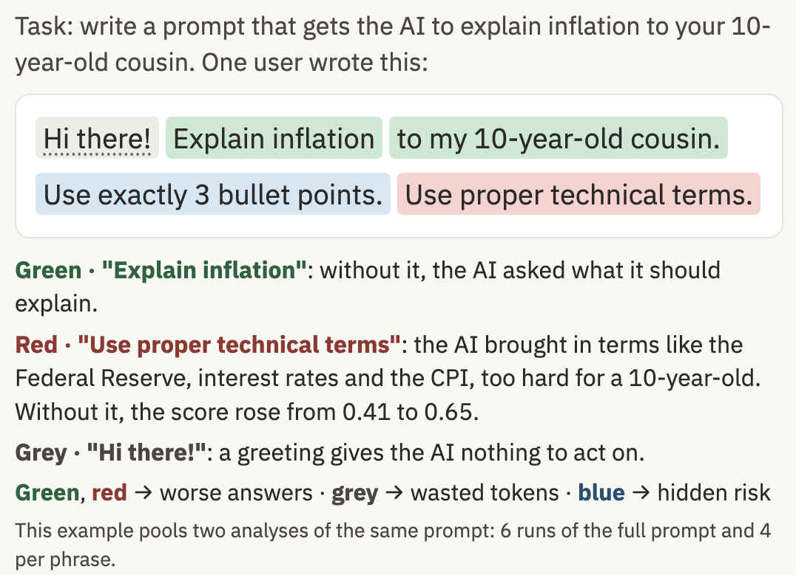
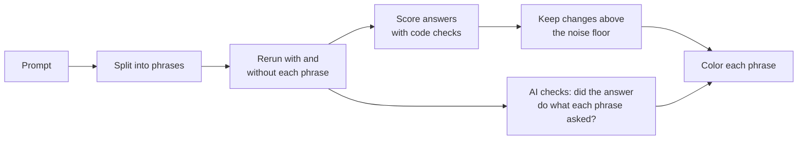
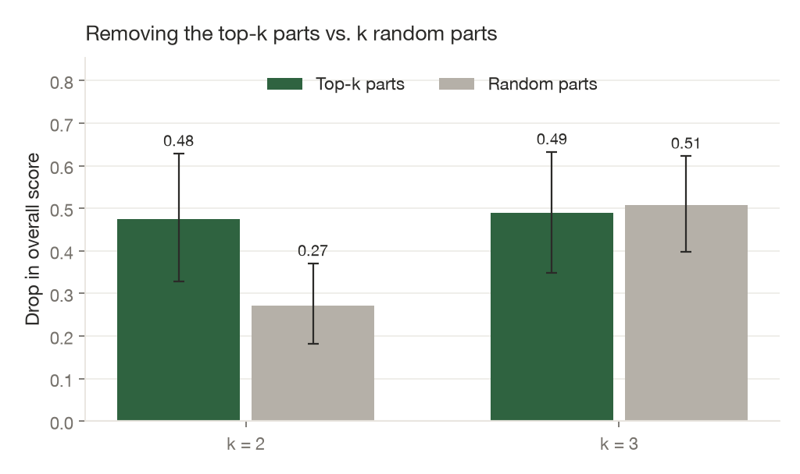
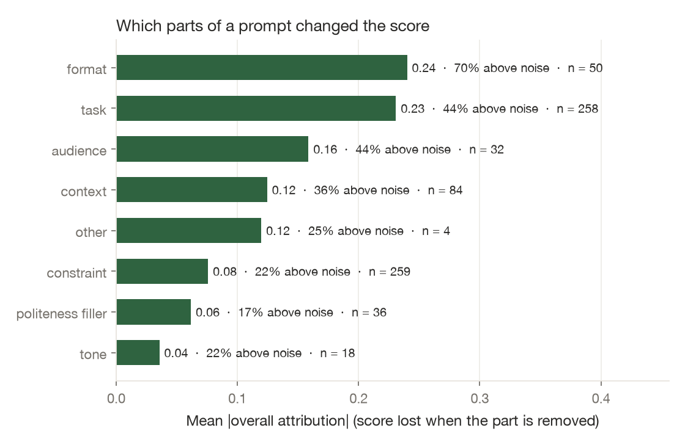

# prompting-explained

A teaching tool that shows which parts of your prompt changed an AI's answer.

## Why this exists

Many people who use AI tools have never been taught how to write a prompt, so they learn by trial and error. They type a request, get an answer, and see nothing about which of their words the model acted on. In one study, non-experts wrote prompts the way they would instruct a person, and struggled to fix them when the answer went wrong (Zamfirescu-Pereira et al., 2023). Small wording changes can also matter a lot: changing only a prompt's formatting moved one model's accuracy by up to 76 points (Sclar et al., 2024).

For a company rolling out AI tools, this has three costs:

- **Worse answers.** A missing instruction, or one that works against the goal, goes unnoticed.
- **Wasted tokens.** Phrases that ask for something the AI does anyway still cost money and context on every call.
- **Hidden risk.** A safety instruction such as "leave out customer details" may not be doing anything, and nothing tells the user.

Prompting guides give general tips. This tool shows a person what their own prompt did, on a task they recognize.

**Who it's for:**
- **Everyday users** who want better answers and don't know how the model works.
- **Employees at companies adopting AI**, who could practice on their company's own tasks and documents.
- **Governance and compliance teams**, who could check whether a safety instruction changes the answer before it goes into a shared prompt.

**Scope:** the tool is built for everyday tasks with goals code can check, such as explaining, writing, and extracting. It is not designed for personal or sensitive conversations, such as therapy, where a good answer can't be scored by a checklist.

## A worked example



Two phrases aren't described in the image:
- **"to my 10-year-old cousin."** is green: without it, the answer got longer and more formal.
- **"Use exactly 3 bullet points."** is blue: without it, the answers stopped using bullets, but the score change (0.10) was within the noise (0.11).

The lesson for the learner is concrete: two of their instructions pulled in opposite directions, and "Use proper technical terms" cost them points with the audience they cared about. This example is sample 3 in the app (`demo_examples/explain_to_kid__3.json`).

## How it works



Each step below gives the choice made and the reason for it.

**1. Pick a task.** The learner picks one of the project's 8 everyday tasks, such as explaining inflation to a 10-year-old or replying to a landlord about a late fee. Each task has a checklist that code can score, which gives "did this phrase help?" a measurable answer. Some tasks attach a document, such as the landlord's email. It is added after the prompt and never removed, because the question is about the learner's own wording.

**2. Split the prompt into phrases.** One model call splits the prompt into 3 to 10 parts and labels each with a role: task, audience, format, constraint, context, tone, role, example, politeness, or other. Code maps each part back onto the exact characters of the prompt, so removing a part removes exactly that text, typos included. Phrases are the unit, not single words as in LIME (Ribeiro et al., 2016), because phrases are what people write and edit. Removing single words would also break sentences and multiply the number of model calls. The 10-part cap keeps one analysis within a 60-call budget. If the model's split doesn't reproduce the prompt exactly after two tries, a rule-based split on sentences and commas is used instead.

**3. Run the full prompt 3 times and score each answer.** The model is Claude Haiku 5.5 with thinking off and low effort, which is cheap and fast enough for a learner to wait for. The model doesn't accept a fixed temperature, so answers vary from run to run, and one run can't tell a real effect from chance. Each answer is scored from 0 to 1 by code, not by another model. For the inflation task the checks are "explains why prices rise", "exactly 3 bullets", "60 words or fewer" and "reading grade 5 or below". Code checks are repeatable and can be audited, and a model judge turned out to be unreliable at counting words (see Results). Seven of the 8 tasks also have a gate check, "did it actually do the task", which multiplies the score. Without the gate, an answer of "What would you like me to explain?" passed the length and reading checks and scored higher than a real answer.

**4. Remove one phrase at a time and run each version twice.** A phrase's effect is the full prompt's mean score minus the mean score without it. This is occlusion, or leave-one-out attribution (Zeiler and Fergus, 2014). Each removal is also a minimal counterfactual: the smallest change to the prompt, and what changed in the answer. Each version runs twice because in early testing a single run made "Thanks so much!" look like it improved reading level, and the effect went away with two runs. More runs gave only small gains for the cost (see Results). Effects are computed for the overall score and for each check, so "under 60 words" can help length and do nothing for reading level.

**5. Compare each effect with its own noise floor.** A change only counts if it is larger than two standard errors of the difference between the runs with the phrase and the runs without it, with a minimum of 0.05. The minimum exists because when all runs happen to agree, the standard error is 0 and any tiny change would count. Each phrase gets its own floor because one floor for the whole prompt produced false results: when the full prompt's 3 runs happened to agree, "im so sorry to bother u" showed as hurting the answer. If the floor is large (0.2 or more) and the score did move, the tool says "not clear" instead of "no difference", so it doesn't teach a lesson the data can't support.

**6. Remove the quiet phrases together.** If two or more phrases had no clear effect alone, they are removed all at once and run twice more. This catches phrases that cover for each other. "Short" and "under 60 words" each look unimportant alone, because the other still keeps the answer short. Shapley values (Lundberg and Lee, 2017) would test every combination, but that takes exponentially many runs. One joint test is a cheap partial check.

**7. Check each phrase directly.** Code checks can't see everything. They can't tell whether a landlord reply still says "I paid on time". So a second model call reads every answer and rates whether it does what each phrase asked: yes, partly, no, or nothing to act on. Phrases the answers did with the phrase and mostly stopped doing without it, while the score didn't move, are blue ("AI followed it"). Phrases done either way are grey ("did it anyway"). Green and red always come from the code scores.

**8. Write the explanation.** For up to 3 phrases that mattered or that the AI followed, the model writes one sentence comparing the answers with and without the phrase. All other text is a fixed template filled with numbers computed by code. The model's sentence describes the two answers. It is not evidence of why the model behaved as it did, since language models' own explanations can be unfaithful (Turpin et al., 2023). The app's "How it works" tab shows the scores, noise floors and ratings behind every color.

## Results

A teaching tool has to point at the phrases that really mattered and give the same lesson when run again. The evaluation tests both, then looks at what the tool showed about prompts.

**Test prompts.** There are 240 prompts: 8 tasks × 3 personas (novice, average, expert) × 10. Claude Haiku 5.5 wrote them, playing each persona (`results/attempts.jsonl`). Expert prompts scored higher than novice ones on every task (0.97 vs 0.59 on average). The gap was largest where no document was attached (0.94 vs 0.36 on the inflation task) and smallest where the document carries the answer (1.00 vs 0.87 on the bug report). This shows where learners have the most to gain.

**1. It mostly points at the right phrases (faithfulness).** For the 79 prompts with at least 4 phrases, the 2 top-ranked phrases were removed together, with new model calls, and compared with removing 2 random phrases. This is the deletion test (Petsiuk et al., 2018; DeYoung et al., 2020). Removing the top 2 dropped the score by 0.30 on average, against 0.18 for random phrases (one-sided Wilcoxon p = 0.0002). The gap was large where wording matters: the inflation task (0.77 vs 0.45), JSON extraction (0.60 vs 0.27) and the FAQ task (0.42 vs 0.28). There was no gap on the landlord and meeting tasks, where removing any 2 phrases moved the score by less than 0.07 because the attached document carries the answer. With 3 phrases removed there was no difference (0.36 vs 0.35). Most prompts have only 4 or 5 phrases, so 3 random ones overlap heavily with the top 3, which makes this a weak test.

For a learner, this means the colors teach the most on tasks where wording matters. Where a document does the work, the tool mostly reports that little in the prompt mattered, which is a lesson in itself.



**2. It usually gives the same lesson twice (stability).** 80 prompts were analyzed a second time with the same phrases and new model calls (Alvarez-Melis and Jaakkola, 2018). The top phrase was the same 78% of the time, and 86% when it had cleared the noise floor. The helped / hurt / no difference verdict matched for 81% of phrases. Splitting the same prompt 3 times gave identical phrases 89% of the time.

To see what more runs would buy, the same prompts were run 12 times in full and 12 times per removed phrase, and pairs of analyses were built from separate halves of those runs:

| Full runs / runs per phrase | Model calls per analysis | Same verdict per phrase | Same top phrase |
|---|---|---|---|
| 3 / 2 (the app) | 9 | 83% | 83% |
| 4 / 3 | 13 | 87% | 85% |
| 5 / 4 | 17 | 89% | 86% |
| 6 / 6 | 24 | 91% | 89% |

Nearly tripling the calls raises agreement by about 8 points. The share of phrases shown as "no difference" barely changes (61% to 57%), so most grey verdicts are real non-effects, not hidden small ones. The app keeps 3 / 2.

**3. What it showed about prompts.** The chart groups all 741 phrases by the role the splitting model gave them in step 2. Each bar is the average score change when phrases with that role were removed. "Other" (4 phrases) and "example" (none) are left out. The roles come from the model and were not checked by hand.



- **Format and task instructions moved the score most.** Partly, this is because some checklists reward a format the task never states, such as exactly 3 bullets.
- **Politeness and tone barely moved it** in either direction.
- **45% of phrases asked for something the AI did anyway.** For a learner, these are the phrases that can be cut.
- **Some instructions backfire.** Besides "Use proper technical terms" in the worked example, "dont guess" made the AI speculate more about whether a gym has a pool its FAQ never mentions (score 0.58 with it, 0.89 without it).

**4. Where the tool is less reliable.** Some phrases ask for exactly what a code check measures, such as "under 60 words" or "only JSON". On 1,139 such answers, the step 7 judge agreed with the code 88% of the time. It is reliable on format (bullets 96%, JSON 93%). It can't count words: 93 times it said an answer met a word limit that it broke. Because green and red come from code, these errors affect only the blue and grey labels.

**5. Comparison with predictions written before the runs.** An AI assistant predicted the color of 71 phrases in 24 clean prompts and 85 phrases in 32 messy ones (typos, text-speak, counterproductive instructions) before any analysis ran. The tool matched 76% of the clean predictions (Cohen's kappa 0.60) and 52% of the messy ones (kappa 0.21). The disagreements were then reviewed against the answers, also with an AI assistant. Most came from the predictions underestimating what the model does unprompted, such as keeping replies short without a limit. About 6 of the 41 messy-prompt disagreements pointed at real problems in the tool, which were fixed. This is a consistency check, not human ground truth (`results/messy_prompt_testing.md`).

## Limitations

- **Teaching value is not yet measured.** There is no study with real users, so it's unknown whether people write better prompts after using the tool.
- **One model, generated prompts.** Results are for Claude Haiku 5.5 on 8 tasks, with test prompts written by a model playing users. Other models may behave differently.
- **Over-trust.** A colored prompt looks more certain than the evidence is. The grey and "not clear" verdicts and the "How it works" tab are there to counter this, but in a teaching tool a confident wrong color teaches a wrong habit.

## What's next

- **A user study.** Do people write better prompts after using the tool, and do they trust the colors more than they should?
- **Company tasks.** Let a team load its own tasks, documents and checklists, so staff practice on their real work and compliance teams can test safety instructions.
- **Interactions.** Use KernelSHAP over phrases to catch phrases that only matter together.
- **More models.** Check which lessons hold across models and which are specific to one.
- **A prompt middle layer (stretch goal).** Train a small local model on many analyses so it can sit between the user and Claude. Before a prompt is sent, it would strip phrases that consistently made no difference, such as greetings and "please", and add ones that consistently helped, such as a length limit.

## Run it locally and reproduce the results

The live app is at [prompting-explained on Streamlit](https://prompting-explained-ff9p8cir8awbkcwsgf3t34.streamlit.app/). It is private, so it may ask you to sign in.

To run it locally you need Python 3.11 or newer (developed on 3.12). Live analyses also need an Anthropic API key. No model downloads are needed, because every model call goes through the Anthropic API.

```bash
python3.12 -m venv .venv
.venv/bin/pip install -r requirements.txt
cp .env.example .env        # add ANTHROPIC_API_KEY
.venv/bin/streamlit run app/streamlit_app.py
```

Without a key, choose a task, switch to **Samples**, and open a saved analysis. One live analysis makes about 15 to 50 calls to Claude Haiku 5.5. The model, run counts and noise floor are set in `config.yaml`.

Tests use a fake model and make no API calls:

```bash
.venv/bin/pytest
```

Every model output from the evaluation is saved under `results/`, so the numbers, tables and plots above can be regenerated without an API key:

```bash
.venv/bin/python scripts/run_eval.py --stage report
```

To rerun the evaluation with new model calls (about $1.30 at the prices in `config.yaml`), run `scripts/generate_attempts.py`, `scripts/run_eval.py`, `scripts/runs_experiment.py` and `scripts/validate_expectations.py`. New runs will differ slightly, because the model's answers vary.

| Path | Contents |
|---|---|
| `core/` | The method: splitting, scoring, occlusion and noise floors, the per-phrase check, verdict text |
| `app/` | The Streamlit app |
| `challenges/` | The 8 tasks as YAML files |
| `scripts/` | Evaluation scripts |
| `results/` | Test prompts, every saved analysis, summaries and plots |

## References

- Alvarez-Melis, D. and Jaakkola, T. (2018). On the robustness of interpretability methods. *ICML Workshop on Human Interpretability*.
- DeYoung, J. et al. (2020). ERASER: A benchmark to evaluate rationalized NLP models. *ACL*.
- Lundberg, S. and Lee, S.-I. (2017). A unified approach to interpreting model predictions. *NeurIPS*.
- Petsiuk, V., Das, A. and Saenko, K. (2018). RISE: Randomized input sampling for explanation of black-box models. *BMVC*.
- Ribeiro, M. T., Singh, S. and Guestrin, C. (2016). "Why should I trust you?" Explaining the predictions of any classifier. *KDD*.
- Sclar, M. et al. (2024). Quantifying language models' sensitivity to spurious features in prompt design. *ICLR*.
- Turpin, M. et al. (2023). Language models don't always say what they think. *NeurIPS*.
- Zamfirescu-Pereira, J. D. et al. (2023). Why Johnny can't prompt. *CHI*.
- Zeiler, M. D. and Fergus, R. (2014). Visualizing and understanding convolutional networks. *ECCV*.

MIT License.
